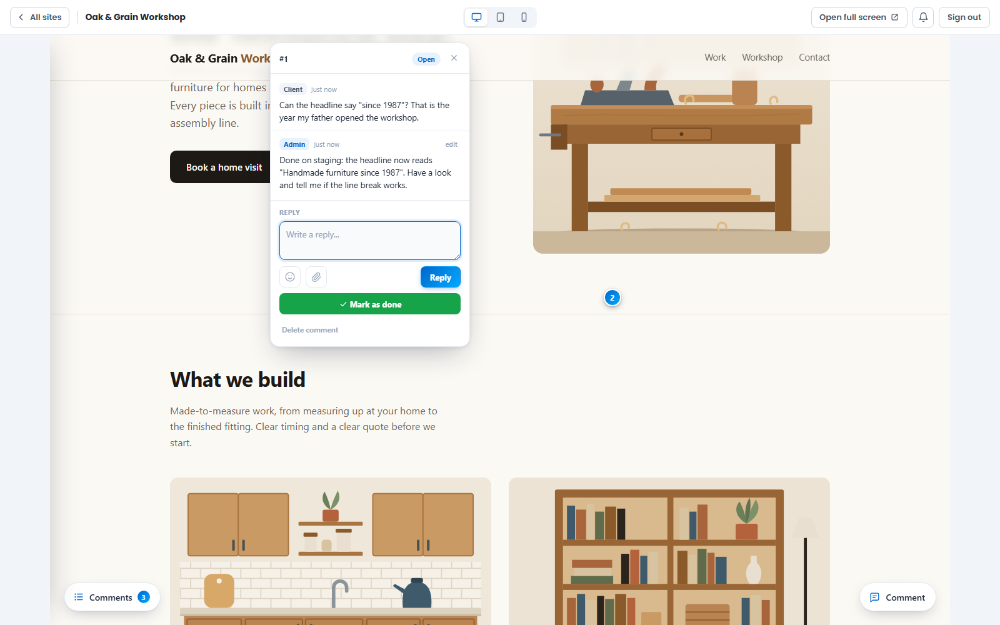
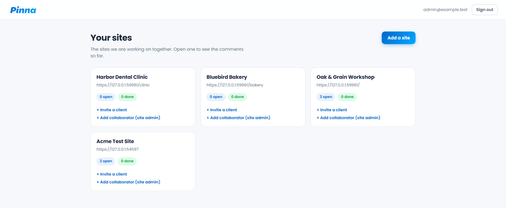

# Pinna

[](https://github.com/Michel9329/pinna/actions/workflows/test.yml)

A self-hosted tool for visual feedback on websites. A reviewer opens the site inside Pinna, clicks a point on the page and leaves a comment pinned to that point. The team replies in the same thread, attaches files and marks the comment done. It runs on your own Cloudflare account: one Worker, one D1 database, one R2 bucket and one KV namespace.

Built with Claude Code, designed and reviewed by Michel Dimitri.



Pinna was built for Sharkcode, a small web studio, and is used in its client reviews.

## Who it is for

Developers, freelancers and small studios who send a staging site to a client and want the feedback in one place, attached to the exact spot, instead of spread over emails and annotated screenshots. Reviewers need no account with a third party: they sign in with their email address. The data stays on your Cloudflare account.

## What it does

- **Comments pinned to a point.** The reviewer turns on comment mode, clicks the page and writes. A pin stores the page path, a CSS selector of the element under the click with the offset inside it, and the page coordinates as a fallback, so it follows its element when the layout moves.
- **Pins per viewport.** The review frame switches between Desktop (1440 px wide, scaled down to fit the screen), Tablet (768 px) and Phone (390 px). A comment belongs to the width band it was written in (up to 460 px is a phone, up to 900 px a tablet, wider is desktop) and is shown only there.
- **Threads.** Replies are one level deep. Authors edit their own comments and delete their own replies. Deleting a pin deletes its whole thread, so its author can delete it only while every reply and file in it is theirs; otherwise it takes a project admin. Project admins mark comments done, reopen them and delete anyone's. A sidebar in the frame lists open and done comments across pages, with search and an author filter. The widget refreshes the list every 20 seconds while the tab is visible.
- **Attachments.** PNG, JPEG, WebP, GIF and PDF, up to 10 MB each and 10 per comment. The type is read from the file's first bytes, not from what the browser declares, and the stored name gets that type's extension when it lacks one (a PDF named `invoice.cmd` is saved as `invoice.cmd.pdf`).
- **Server-side screenshot (optional).** When a reviewer places a pin, the widget sends a copy of the page's DOM to the Worker. Cloudflare Browser Run (formerly Browser Rendering) opens it in headless Chrome with JavaScript off, scrolls to the same point, draws a dot where the reviewer clicked and attaches the JPEG to the comment. If the screenshot fails or takes too long, the comment is saved without it. The snapshot is the whole document, not only the visible part: hidden fields, attributes and the text of inline scripts leave the browser too. It is sent on the click that places the pin, even if the reviewer then cancels the comment, and even when screenshots are not configured. Only the JPEG is stored; the markup is not. If you review pages that show personal data, read [what leaves the browser](SECURITY.md#server-side-screenshots).
- **Sign-in without passwords.** Pinna emails a link and a 6-digit code. The code is there because many people read the email on their phone, inside the mail app: a tapped link opens the app's built-in browser, the session cookie lands there, and the person finds they are signed out when they come back in their usual browser. Typing the code into the Pinna page they already have open keeps the session where they work. Opening the link does not sign anyone in by itself: it shows a page with a button, because mail scanners open links before the recipient does. The page names the account the link signs into, masked (`a***@example.com`).
- **Roles per project.** `admin` (global, from a list of emails in the configuration), `collab` (admin only on the projects where they were added as a collaborator) and `client` (comments on the projects they were invited to). Details in [SECURITY.md](SECURITY.md#roles).
- **Email notifications.** A client's comment notifies the project's team. A team member's comment, reply or status change notifies the project's clients. At most one email per person per project every 30 minutes, none for people who muted notifications, and all emails share one cap per 24 hours (80 by default).
- **Widget in three languages.** English by default, with Italian and Spanish.
- **Review through a proxy, off by default.** For sites that refuse to be framed. It carries real risks: read [its section](#review-through-the-proxy-off-by-default) before turning it on.



An admin sees every project. Everyone else sees the projects they were invited to.

Not included:

- No screen to remove a member or to sign a user out. Both exist as API routes (see [API](#api)). There is no way to change a project's staging URL or to delete a project.
- No email is sent when you invite someone. Tell them to open Pinna and sign in with that address.
- No real-time push: the widget polls.
- Comments are tied to the page path. Pages that differ only by query string share their comments.
- One instance serves one team. There is no sign-up page and no billing.

## How it works

```
 Reviewer's browser
 +----------------------------------------------------+
 | Pinna app (Vue 3, served by the Worker)            |
 |   +--------------------------------------------+   |
 |   | iframe: the staging site                   |   |
 |   |   + pinna.js (widget, in a Shadow DOM)     |   |
 |   +--------------------------------------------+   |
 +-----------+----------------------------+-----------+
             | session cookie + CSRF      | widget token (Authorization header)
             v                            v
   Cloudflare Worker (Hono) ---> D1     users, projects, comments, counters
                            ---> R2     attachments and screenshots
                            ---> KV     alert counters
                            ---> Browser Run (optional), Resend (email)
```

1. The app loads the staging URL in an iframe, with a few `pinna_*` parameters in the query string: the project slug, the role, and `pinna_pm=1`, which tells the widget to wait for a token from the app.
2. The widget on the staging site sees that it is inside Pinna's frame and waits. The app sends it a widget token with `postMessage`, addressed to the staging origin only. The token never appears in a URL.
3. The widget calls the API with `Authorization: Bearer <token>`. The token lasts one hour. On a 401 the widget asks the app for a new one.
4. The widget token cannot change other people's work. To mark a comment done, reopen it, or delete someone else's comment or file (or a thread that holds someone else's reply), the widget asks the app; the app shows a confirmation bar in its own page, one request at a time, and after the click calls the API with the session cookie and the CSRF token.
5. In direct mode the iframe is sandboxed without top navigation: the staging site cannot navigate Pinna's tab away.

| Path | What it is |
| --- | --- |
| `worker/` | The Worker: API routes, sign-in, tokens, rate limits, uploads, screenshots, proxy, notifications, daily cron |
| `app/` | The Vue 3 single page app: sign-in, project list, review screen. Built with Vite |
| `widget/pinna.js` | The comment overlay loaded by the reviewed site. Plain JavaScript, minified at build time. `widget/demo.html` runs it with an in-memory store and is served as `/demo.html` |
| `migrations/` | D1 schema, applied in order by Wrangler |
| `scripts/build.mjs` | Builds the app, minifies the widget and copies the demo page into `app/dist` |
| `test/`, `e2e/` | Unit tests (`bun test`) and browser tests (Playwright) |

Data model, in short:

- `users`: email, name, global role. Only `admin` grants anything by itself.
- `projects`: name, slug, staging URL.
- `memberships`: user, project and the role on that project (`collab` or `client`).
- `comments`: a pin (no parent) or a reply, with page path, selector and offsets, page coordinates, viewport band, text, author and status (`open` or `done`).
- `attachments`: metadata of the files in R2. A file uploaded but never attached to a comment is a draft; after 24 hours it can no longer be attached, and the daily cron deletes it.
- `magic_links`: hash of the sign-in token, the 6-digit code, attempts and expiry.
- `session_revocations`: a cutoff per user. Tokens issued before it are refused.
- `rate_limits`: counters, one row per rule, key and time window.
- `notification_prefs`, `notify_state`: mute flag, and the last notification per user and project.
- `admin_audit`: every attempt to use the admin key.

## Requirements and running costs

- A Cloudflare account with a domain on it. Pinna answers on its own route (`pinna.example.com` in `wrangler.toml`), and `workers_dev = false` keeps the `workers.dev` address off.
- [Bun](https://bun.sh) for dependencies, tests and scripts, and Node.js 22 or newer (Wrangler requires it; the build script also calls `npx esbuild`).
- A [Resend](https://resend.com) account with a verified sending domain. Without `RESEND_API_KEY` nobody can sign in by email.

What Pinna uses, and the caps the code puts on it:

| Service | Used for | Caps in the code |
| --- | --- | --- |
| Workers | API, app, widget, daily cron at 03:00 UTC | 60 write requests per minute per user |
| D1 | All data, rate limit counters | Counter windows older than 2 days are deleted daily |
| R2 | Attachments and screenshots | 200 MB and 1,000 files per project; 100 MB and 200 files per user per day |
| KV | Alert counters only | Up to 20 counter writes per error type until the counter expires (25 hours), plus one per alert sent; errors that arrive together can add a few, because KV reads and writes are separate steps |
| Workers Rate Limiting | Shields on anonymous routes and per user | Counted in memory, no storage writes |
| Browser Run (optional) | Screenshots | 5 per minute and 50 per day per user, 150 per day per project, 10 seconds each |
| Resend | Sign-in and notification emails | 80 per 24 hours by default (`PINNA_EMAIL_DAILY_CAP`) |

Prices and free allowances change, so they are not copied here. Before you deploy, check Cloudflare's [Workers pricing](https://developers.cloudflare.com/workers/platform/pricing/), the [Browser Run limits](https://developers.cloudflare.com/browser-run/limits/) for your plan, and the daily quota of your Resend plan. Browser Run is the one piece you can leave out: delete the `[browser]` block from `wrangler.toml` and `/shot` answers 503; the widget then saves comments without a screenshot.

## Setup

### 1. Install and create the resources

```bash
git clone https://github.com/Michel9329/pinna.git && cd pinna
bun install
cd app && bun install && cd ..

bunx wrangler login
bunx wrangler d1 create pinna                   # prints the database_id
bunx wrangler kv namespace create RATE_LIMIT    # prints the namespace id
bunx wrangler r2 bucket create pinna-attachments
```

### 2. Edit `wrangler.toml`

| What | Where |
| --- | --- |
| D1 database | `[[d1_databases]]`: put the printed id in place of `REPLACE_WITH_YOUR_D1_DATABASE_ID`. Keep `database_name = "pinna"`: the `db:migrate*` and `deploy*` scripts use that name |
| KV namespace | `[[kv_namespaces]]`: put the printed id in place of `REPLACE_WITH_YOUR_KV_NAMESPACE_ID`. The binding stays `RATE_LIMIT` |
| R2 bucket | `[[r2_buckets]]`: `bucket_name = "pinna-attachments"` |
| Domain | `[[routes]]`: replace `pinna.example.com` with your hostname, on a zone of the same Cloudflare account (`custom_domain = true`) |
| Rate limiting | `[[ratelimits]]`: each `namespace_id` is an integer of your choice, unique in the account. Nothing to create beforehand. Keep `limit` and `period` equal to `ANON_LIMIT`/`ANON_PERIOD` and `USER_LIMIT`/`USER_PERIOD` in `worker/rate-limit.ts` |

### 3. Deploy

```bash
bun run deploy
```

This applies the D1 migrations, builds the app and the widget, and deploys the Worker, in that order. If the migrations fail, nothing else runs. Until `SESSION_SECRET` is set (next step) the API answers 503; that is expected.

### 4. Secrets

```bash
openssl rand -hex 32      # run it twice: one value for SESSION_SECRET, one for ADMIN_KEY
bunx wrangler secret put SESSION_SECRET
bunx wrangler secret put ADMIN_KEY
bunx wrangler secret put RESEND_API_KEY
bunx wrangler secret put ADMIN_EMAILS        # you@example.com
bunx wrangler secret put PINNA_FROM_EMAIL    # Pinna <noreply@example.com>
bunx wrangler secret put ALERT_EMAIL         # optional: where alerts go
```

At the prompt, paste the value as it is, without quotes: quotes become part of the value.

### Configuration

| Name | Kind | What it does | When it is missing |
| --- | --- | --- | --- |
| `SESSION_SECRET` | secret, required | Signs every token (sessions, widget, attachment and proxy tokens). At least 32 characters | `/api/*`, `/entra` and `/_proxy` answer 503. The app's static files are still served |
| `ADMIN_KEY` | secret | Key for `/entra` and `/api/summary`. At least 32 characters | No admin key is accepted. The same when it is shorter than 32 characters |
| `RESEND_API_KEY` | secret, required for email | Sends sign-in and notification emails | Sign-in requests answer 503 for every address |
| `ADMIN_EMAILS` | secret or var | Global admins, separated by commas, semicolons or spaces. Quotes, apostrophes, angle brackets and parentheses are stripped from each entry, so `Name <you@example.com>` also works | Missing configuration: roles stay as stored, nobody is promoted or demoted, `/entra` does not sign in. See [First admin](#first-admin) |
| `PINNA_FROM_EMAIL` | secret or var | Sender, e.g. `Pinna <noreply@example.com>`, on a domain verified in Resend | `Pinna <onboarding@resend.dev>`, which Resend delivers only to the address of your own Resend account |
| `ALERT_EMAIL` | secret or var | Receives alerts (bursts of errors, email cap reached) and a daily error digest | Errors are counted in KV, no email is sent |
| `PINNA_PUBLIC_URL` | var | Public address used for links and the logo in emails | The origin of the request |
| `PINNA_EMAIL_DAILY_CAP` | var | Cap on sign-in and notification emails in the last 24 hours. A quarter of it is kept for admins signing in | 80 |
| `PINNA_SHOT_ASSET_ORIGINS` | var | Extra https origins from which `/shot` may load images, CSS, fonts and media, comma separated, e.g. `https://cdn.example.com` | Only the staging origin and `data:` URLs: assets served from a CDN are missing from screenshots |
| `PINNA_PROXY_ENABLED` | var | `1` turns on `/_proxy` | Proxy off and its button hidden |
| `PINNA_DEV_MODE` | local only | `1` puts the sign-in link and code in the API response, on localhost and without `RESEND_API_KEY` | Never set it on a deployed Worker |

Bindings, all in `wrangler.toml`: `DB` (D1), `ATTACHMENTS` (R2), `RATE_LIMIT` (KV), `ANON_RL` and `USER_RL` (Workers Rate Limiting), `BROWSER` (Browser Run), `ASSETS` (the built app in `app/dist`).

### First admin

The migrations create no user. Put your address in `ADMIN_EMAILS`, then either:

- open `https://pinna.example.com/login`, enter that address and use the code or the link from the email; or
- open `https://pinna.example.com/entra#k=<ADMIN_KEY>` (next section), which needs no email.

On an instance with no admin yet, a listed address becomes admin at its first sign-in.

From then on the admin role is computed from `ADMIN_EMAILS` on every request. Remove an address and that user becomes a `client`: they keep their memberships and project roles, and all their sessions and widget tokens are revoked. The daily cron demotes those who make no requests.

Only a list that is valid, not empty and contains at least one admin already in the database can demote anyone. An absent or empty list, a list without any `name@domain` entry, or a list that contains none of the current admins (a typo, for example) is treated as missing configuration: roles stay as they are in the database, `/entra` does not sign in, and the Worker logs an error. To hand an instance to another admin, add the new address, let them sign in once, then remove the old one.

### Signing in with the admin key

Bookmark `https://pinna.example.com/entra#k=<ADMIN_KEY>` ("entra" is Italian for "enter"). The key sits in the fragment, which the browser never sends to the server: the page reads it, removes it from the address bar and sends it in a POST to `/entra`. You enter as the first address in `ADMIN_EMAILS` that already has an admin account or, if none has, as the first address, created as admin. Put `?goto=/p/<slug>` before the `#` to land on a project. A key in the query string (`/entra?k=`) is refused without being checked.

`/api/summary` takes the same key, only in the `X-Admin-Key` header, and returns every project with its open and done counts, for a dashboard or a script.

## Adding the widget to a site

Add one line to the pages of the staging site, before `</body>`, with your Pinna hostname:

```html
<script src="https://pinna.example.com/pinna.js" defer></script>
```

For normal visitors it does nothing: the widget wakes up only inside Pinna's frame, after the app hands it a token. It can stay in production builds.

- The site must allow being framed by Pinna. If it sends `X-Frame-Options` or a `frame-ancestors` policy, allow your Pinna origin, e.g. `Content-Security-Policy: frame-ancestors 'self' https://pinna.example.com`.
- If the site has its own Content Security Policy, it must let the widget load (`script-src` with your Pinna origin) and call the API (`connect-src` with the same origin). Image thumbnails in the widget are `data:` URLs (`img-src data:`).
- The site must be served over https: the app's Content Security Policy only allows https frames (`frame-src https:`).
- The frame is sandboxed ([details](SECURITY.md#the-review-frame)). Links and scripts on the site that target the top window do not navigate Pinna's tab; new tabs and popups, `alert`/`confirm` dialogs and downloads still work.
- `data-pinna-lang="en"`, `"it"` or `"es"` on the tag picks the widget language. Without it the browser's language decides, and anything other than Italian or Spanish gets English. `?pinna_lang=` in the page URL takes precedence.
- Do not put `data-pinna-project` on the tag of a real site: outside Pinna's frame it turns on demo mode (an in-memory store with a sample thread) for every visitor. `/demo.html` on your instance is the page made for that.

Then, signed in as admin, create a project with a name and the staging URL. Only `http` and `https` URLs are accepted, without credentials, and a hostname that resolves to a private or internal address is refused. From the project card, invite clients by email. A global admin can also add a collaborator, who becomes admin of that project only.

## Review through the proxy (off by default)

**What it is for.** Some sites cannot be reviewed in the frame: they send `X-Frame-Options` or `frame-ancestors`, or you cannot add the script tag (a hosted shop, a third-party builder). With `PINNA_PROXY_ENABLED=1` the review screen shows a proxy toggle. The Worker then fetches the staging page itself, removes the framing rules declared in the HTML, rewrites internal links and forms to go back through `/_proxy`, injects the widget and serves the page to the frame.

**How it is contained.** Every proxy response carries `Content-Security-Policy: sandbox` without `allow-same-origin`, so the proxied page runs in an opaque origin: it cannot read Pinna's cookies, storage or API responses. The proxy ignores the session cookie and authenticates with its own token, bound to the user, the project and the project's staging origin, valid for one hour. It refuses any URL or redirect outside that origin, follows at most 5 redirects, checks the membership on every request, never forwards Pinna's cookies to the site and drops the site's `Set-Cookie`. A request with a body needs a `Content-Length` and stops at 2 MB (411 and 413). Pages count against a limit of 60 per minute per user.

**Why it is risky.** The proxy token travels in the frame's URL (`?pinna_pt=`). Analytics, tag managers and any other script on the staging site can read it and, for one hour, use `/_proxy` on that staging site as the user. Signing out does not cancel it; removing the user from the project does. The token gives no access to Pinna's data, but this is why the proxy stays off unless you need it.

**Limits.** It is for checking look and content, not for testing a checkout:

- Only HTML pages and the site's same-origin `fetch`/`XMLHttpRequest` calls and forms go through the Worker. Images, CSS and scripts load directly from the site through a `<base>` tag.
- The site's own cookies do not persist, so logged-in areas, carts and checkouts can lose state.
- WebSockets, server-sent events and service workers of the site are not handled.
- A script that assigns `location.href` directly navigates the frame to the real site, outside the proxy.
- On single page apps that handle clicks on `document`, internal links become full page loads through the proxy instead of client-side transitions.
- A redirect to another origin (for example from the bare domain to `www`) is refused with a message: set the project's staging URL to the final address.

## Local development

```bash
cp .dev.vars.example .dev.vars    # set SESSION_SECRET (32+ characters)
bun run db:migrate:local
bun run build                     # the Worker serves the app from app/dist
bun run dev                       # http://localhost:8787
bun run typecheck                 # Worker; `cd app && bun run typecheck` for the app
```

With `PINNA_DEV_MODE=1` and no `RESEND_API_KEY` in `.dev.vars`, a sign-in request returns the link and the code in its response and the login page shows the code. This works only when the request's host is `localhost`, `127.0.0.1` or `[::1]`. In dev mode a project's staging URL may also point to localhost or a private address.

`bun run dev` runs `wrangler dev --ip 127.0.0.1 --local-upstream localhost:8787`. `--local-upstream` makes the Worker see `localhost` as the host; without it Wrangler uses the production route's hostname, dev mode stays off and email links point at the real domain. The same flag means every request looks like `localhost`, whoever sends it. That is why the server listens on `127.0.0.1` only (in the script and in `[dev]` of `wrangler.toml`): never run it with `--ip 0.0.0.0` while dev mode is on, or anyone on the same network could sign in as anyone. On another port: `bunx wrangler dev --ip 127.0.0.1 --port <N> --local-upstream localhost:<N>`.

The cookies are named `__Host-pinna_session` and `__Host-pinna_csrf`, so they require `Secure`. Chromium keeps them on `http://localhost`; WebKit drops them there, which is why the browser tests run `wrangler dev` over https (`--local-protocol https`). The review frame also needs an https staging site, so trying the whole flow locally means serving a sample site over https, as the browser tests do.

## Tests

```bash
bun test
```

The unit tests call the Worker's Hono app directly, against an in-memory SQLite database (`bun:sqlite`) with the real migrations applied, with minimal fakes for KV, R2 and the execution context and a fake DNS resolver. They need no network and no Cloudflare account. They cover roles and project access, the powers of each token type, who can delete a thread, the fields every comment answer returns, control characters in comments, CSRF, sign-in (links and the masked account, the limits on the link routes, codes, lockouts, caps on emails), revocation, rate limits, the project caps under parallel requests, upload checks, file names and their agreement with the file type, draft linking, the screenshot guards and the cleaning of the snapshot markup, the SSRF and DNS checks, the proxy, retention and the deploy scripts. `test/security-doc.test.ts` fails if `SECURITY.md` loses one of its [Known limits](SECURITY.md#known-limits), or if one of the security sentences it pins in either document changes.

```bash
bun run test:e2e
```

The browser tests drive Chromium, Firefox and WebKit with Playwright: sign-in with the email link (page with a button, POST, session), with the code and with `/entra#k=`; from the widget on a sample site, creating, editing and deleting one's own comment with an image; as admin, resolving and deleting someone else's comment from the app's confirmation bar; as admin, two confirmation requests posted together, where the second is refused and the bar for a thread says how many replies go with it; a thread that someone else answered while it was open, where the admin's delete goes on through the confirmation bar and a client is told that only a project admin can delete it; an element whose `id` is longer than 1,000 characters, where the pin is saved without a selector, on its coordinates; a file with no recorded uploader on one's own comment, which the admin removes through the confirmation bar while a client is told why they cannot; signing out; and, in a phone-sized frame (390 px, where the widget opens its panels as a bottom sheet), checking that the floating buttons do not cover the sheet's Send and Delete comment buttons.

Everything runs locally and is cleaned up at the end:

- a temporary folder with local D1 and R2 (`--persist-to`), the real migrations and invented sample data;
- `wrangler dev` on 127.0.0.1 over https with a throwaway certificate, dev mode on and invented secrets passed with `--env-file` (`.dev.vars` is not read, there is no `RESEND_API_KEY`, no email leaves);
- a sample site on `https://127.0.0.1:<port>` that loads `pinna.js`.

Ports are chosen at run time. The app and the widget are rebuilt if `app/dist` is older than the sources. At the end the suite stops only the processes it started (by PID) and deletes only its temporary folder.

First run: `bun install`, `cd app && bun install`, then `npx playwright install chromium firefox webkit`. The tests need `openssl` for the certificate (set `PINNA_E2E_OPENSSL` if it is not on the `PATH`; on Windows the one shipped with Git is found). `PINNA_E2E_SKIP_BUILD=1` skips the build, `PINNA_E2E_KEEP=1` keeps the temporary folder and the Wrangler log.

CI runs the type checks, the unit tests and the build. The browser tests are not in CI: they need three browsers, `openssl` and a local Worker. Run them before a deploy that touches sign-in, the widget or the app.

## Deploying updates

`bun run deploy` is `wrangler d1 migrations apply pinna --remote && node scripts/build.mjs && wrangler deploy`: migrations first, then the build, then the Worker. If the migrations fail, the Worker is not deployed. The migrations add tables and columns; none drops or rebuilds a table.

If a Worker reaches production before its migrations (a manual `wrangler deploy`), it does not answer 500. Without `0002` every membership counts as `client`; without `0003` revocations are not applied and `POST /api/users/:id/revoke-sessions` answers 503; without `0004` the D1 rate limits are skipped (the `ANON_RL` and `USER_RL` shields still work). Each case is logged.

Secrets survive deploys. `bun run deploy:secrets` runs the same chain but ends with `wrangler deploy --secrets-file .deploy-secrets.env`, uploading the secrets listed in that file (one `NAME=value` per line, ignored by git) in the same version as the code. It is useful when a value that was a plain variable in `wrangler.toml` becomes a secret, so that no version runs without it. Delete the file afterwards.

Turn on `PINNA_PROXY_ENABLED` only after the migrations and the Worker are in place, and only if you need the proxy.

## API

| Method | Route | Auth | Purpose |
| --- | --- | --- | --- |
| GET | `/api/health` | none | Health check |
| GET | `/api/email-preview` | none | The sign-in email rendered with sample data |
| POST | `/api/auth/request` | none (JSON) | Sends a sign-in link and code by email |
| GET | `/api/auth/verify?token=` | none | Page with the sign-in button and the masked account (does not use up the link); an unknown, used or expired link redirects to `/login?err=expired`; past the per-IP limit, a 429 page that asks to wait a minute and reload |
| POST | `/api/auth/verify` | same-origin form | Signs in with the link |
| POST | `/api/auth/verify-code` | none (JSON) | Signs in with the code |
| POST | `/api/auth/logout` | session + CSRF | Signs out on every device |
| GET | `/api/auth/me` | session | Current user |
| POST | `/api/users/:id/revoke-sessions` | admin + CSRF | Signs a user out everywhere |
| GET, POST | `/entra` | admin key in the POST body | Admin sign-in page, then the sign-in itself |
| GET | `/api/summary` | `X-Admin-Key` | Projects with open and done counts |
| GET | `/api/projects` | session | The user's projects |
| POST | `/api/projects` | admin + CSRF | Creates a project |
| POST | `/api/projects/:id/invite` | project admin + CSRF | Adds a client; adding a collaborator is for global admins |
| GET | `/api/projects/:id/members` | project admin | Members and their roles |
| DELETE | `/api/projects/:id/members/:userId` | project admin + CSRF | Removes a member; a collaborator can remove only clients |
| GET | `/api/projects/:slug/widget-token` | session | Widget token, proxy token (when the proxy is on) and the role in the project |
| GET | `/api/projects/:slug/comments` | widget token or session | Comments with a fixed set of fields (the author's role on this project, `mine` on each comment and file, no ids of authors or uploaders, no storage keys), each attachment with a short-lived URL |
| POST | `/api/projects/:slug/comments` | widget token, or session + CSRF | New pin or reply; answers the comment with the same fields as the list, plus `attachments_linked` and `attachments_requested`. Control characters are removed from the text; a page path that holds one gets 400; 413 when the project's comment storage is full |
| PATCH | `/api/comments/:id` | text: the author. Status: project admin, session + CSRF only | Edits a comment; answers it with the same fields as the list. Control characters are removed from the text; 404 if it no longer exists, 413 when a longer text no longer fits |
| DELETE | `/api/comments/:id` | the author, for a reply or for a pin whose whole thread is theirs; otherwise a project admin, session + CSRF only | Deletes a comment with its replies and files |
| POST | `/api/projects/:slug/attachments` | widget token, or session + CSRF | Uploads a file (413 when a project cap is reached) |
| GET | `/api/attachments/:id` | widget token, session or `?at=` | Downloads or shows a file |
| DELETE | `/api/attachments/:id` | the uploader; others: project admin, session + CSRF only | Deletes a file |
| POST | `/api/projects/:slug/shot` | widget token, or session + CSRF | Server-side screenshot (413 when a project cap is reached, also after rendering) |
| GET | `/api/notifications/me` | session | Mute status |
| POST | `/api/notifications/mute` | session + CSRF | Mutes or unmutes notifications |
| any | `/_proxy` | proxy token | Proxied staging page (503 unless `PINNA_PROXY_ENABLED=1`; a request with a body: 411 without `Content-Length`, 413 over 2 MB) |

## Security and known limits

[SECURITY.md](SECURITY.md) describes the model as the code implements it: roles, the token types and what each one can do, sign-in, rate limits, revocation, uploads, the screenshot endpoint and what it takes from the page, headers, the review frame, the proxy and secrets. The code was reviewed adversarially several times before publication, and what remains open is listed in its [Known limits](SECURITY.md#known-limits) section. The ones an installer meets first:

- The widget token lives in the page of the site under review, where third-party scripts can read it. With it they can act as the user on that one project while the page is open in Pinna's frame and for up to an hour after: read its comments and files, add comments and files, edit the user's own, delete the user's own replies and pins whose whole thread is the user's. They cannot resolve or delete other people's work, or do anything an admin does.
- One email cap serves the whole instance. Someone who knows a few clients' addresses can use it up by requesting sign-in emails: email sign-in then stops for every client until the oldest of those emails is 24 hours old, and insisting keeps it stopped. Existing sessions and admin sign-in keep working.
- The proxy, when turned on, puts a one-hour token in a URL that the staging site's scripts can read.
- The staging hostname is checked against internal addresses at project creation and before each screenshot, but DNS rebinding between the check and Chrome's own lookup is not prevented.
- No two-factor authentication. Admin access rests on the email inbox and on `ADMIN_KEY`.

To report a vulnerability, use GitHub's private reporting (see [SECURITY.md](SECURITY.md)).

## License

MIT. See `LICENSE`.

---

## Nota in italiano

Pinna è uno strumento per raccogliere commenti sui siti in revisione, da installare sul proprio account Cloudflare (Worker, D1, R2, KV). Chi rivede il sito lo apre dentro Pinna, clicca un punto della pagina e lascia un commento lì; il team risponde nello stesso thread, allega file e segna il commento come completato. Si entra con un link o con un codice di 6 cifre ricevuti per email, senza password. I ruoli sono per progetto: admin globali, collaboratori (admin solo dei loro progetti) e clienti. Il widget parla inglese, italiano e spagnolo.

L'installazione è nella sezione "Setup" qui sopra. `SECURITY.md` descrive il modello di sicurezza com'è nel codice e, alla fine, i limiti che restano aperti. Il proxy per i siti che non si lasciano incorniciare è spento di default: prima di accenderlo leggi perché.

Costruito con Claude Code, progettato e rivisto da Michel Dimitri.

---

More tools from the same system: [github.com/Michel9329](https://github.com/Michel9329).
